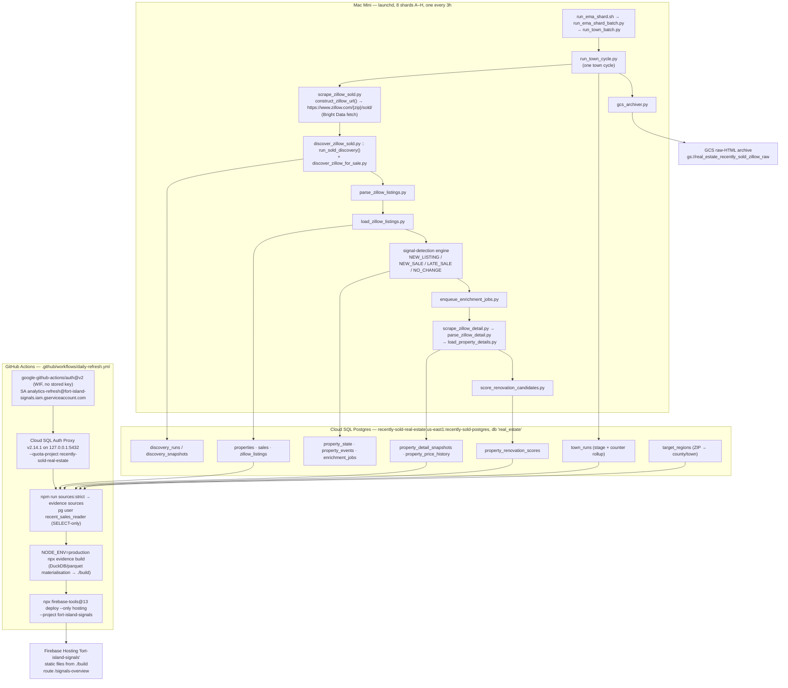

# Signals Overview — end-to-end data flow

Read-only documentation of how data reaches
`https://fort-island-signals.web.app/signals-overview`
(custom domain `https://signals.fortisland.me/signals-overview`).

- **Written:** 2026-11-16
- **Method:** every table, query file, workflow, script and identity below was read
  from a file in this repo or in
  `/Users/erichakanson/projects/recently-sold-real-estate` (rsre), or from the
  GitHub API. Anything inferred rather than read is marked
  **[unverified]**.
- **Scope:** documentation only. No pipeline, workflow, dashboard or database was
  changed, and no `daily-refresh` / `workflow_dispatch` run was triggered
  (FOR-512 / `DATA_PROTECTION.md`).

> **Headline:** the dashboard is not broken — it is **frozen**. The last
> successful build was **2026-08-26**, and the `daily-refresh` workflow has been
> in GitHub state `disabled_inactivity` ever since. See
> [Finding 1](#finding-1--the-nightly-refresh-is-not-running-root-cause-confirmed).

---

## 1. The flow



### 1.1 Producer side (rsre, on the Mac Mini)

Scheduling is `launchd` on a local Mac Mini — **not** GitHub Actions. Per
`docs/EVIDENCE_ANALYTICS_BRIEFING.md`, 88 scheduled municipalities (Essex 34 +
Middlesex 54) are split into 8 non-overlapping shards `A`–`H`, one every three
hours from 12:00 AM ET. **[unverified: shard count/coverage is as the briefing
stated on 2026-04-13; the Mini's live `launchd` state could not be read from this
machine — this checkout is on `Erics-MacBook-Air.local`, not the Mini.]**

Each town is run by `scripts/run_town_cycle.py`, which tracks eight stages
(`scripts/town_run_tracker.py :: PIPELINE_STAGES`):

| # | Stage | Required for `completed`? |
|---|---|---|
| 1 | `listing_discovery` | no |
| 2 | `sold_discovery` | **yes** |
| 3 | `for_sale_discovery` | no (best-effort) |
| 4 | `state_transition` | **yes** |
| 5 | `enrichment_enqueue` | **yes** |
| 6 | `enrichment_execute` | **yes** |
| 7 | `gcs_archive` | no (best-effort) |
| 8 | `scoring` | **yes** |

Stage statuses and aggregate counters land in one `town_runs` row per town per
cycle (`sql/migrations/018_create_town_runs.sql`), including
`for_sale_obs_count`, `new_listing_count`, `new_sale_count`, `late_sale_count`,
`no_change_count`, and the enrichment/scoring counters. **Those four counters are
what the dashboard's "Market Activity" tiles read.**

Signal semantics (briefing + `docs/decisions/ADR-001-signal-detection-engine.md`
in rsre): durable per-property memory lives in `property_state`; transitions are
emitted to `property_events` as `NEW_LISTING`, `NEW_SALE`, `LATE_SALE`,
`NO_CHANGE`. Only `NEW_SALE` and `LATE_SALE` trigger enrichment, one enrichment
job per `(property_key, sale_event_version)`. Identity is `zpid` first,
normalised address as fallback.

Redfin (`scrape_redfin_sold.py`, `load_redfin_listings.py`, …) exists as a
business-continuity second source and is **not** on the scheduled production
path. Nothing on `signals-overview` is source-aware, so Redfin rows — if any were
loaded — would be indistinguishable in these metrics.

**Naming correction:** `real_estate_recently_sold_zillow_raw` is a **GCS bucket**
(raw HTML archive, path convention
`gs://<bucket>/<source>/<location_slug>/<run_id>/<filename>`), not a Cloud SQL
table. Verified in `scripts/run_town_cycle.py:730`, `scripts/gcs_archiver.py`
usage and `docs/GCS_ARCHIVAL.md`. The dashboard never reads GCS.

### 1.2 Consumer side (this repo)

`evidence sources` executes each `.sql` file under `sources/<source>/` against
that source's connection and materialises the result to parquet. `evidence build`
then renders the pages statically; DuckDB is the query engine over those parquet
files (at build time and in the browser), which is why Firebase can serve the
whole site as static files with no server-side compute. The page is a **snapshot
taken at build time** — it never queries Cloud SQL from a visitor's browser.

Routing: `pages/index.md` is a client-side redirect to `/signals-overview`, so
`/signals-overview` is effectively the entire site. `firebase.json` sets
`public: build`, `cleanUrls: true`, a catch-all rewrite to `/index.html`, 1-hour
cache with `stale-while-revalidate` for pages and 1-year immutable for
`/_evidence/**`. `X-Frame-Options` is deliberately absent so Squarespace can
iframe the page.

---

## 2. The actual tables and queries behind `/signals-overview`

The page is `pages/signals-overview.md`. It contains **three** SQL blocks, all
against the `google_cloud_postgresql` source and nothing else:

| Page block | Source query file | Rendered by |
|---|---|---|
| `glance` | `sources/google_cloud_postgresql/signals_overview_glance.sql` | 9 × `<BigValue>` + the `built_at` freshness line |
| `county_map_data` | `sources/google_cloud_postgresql/signals_overview_county_map.sql` | `<AreaMap>` ("Properties by County") |
| `funnel` | `sources/google_cloud_postgresql/signals_overview_funnel.sql` | `<FunnelChart>` ("Property → Candidate Funnel") |

### 2.1 Tables read

Exactly five tables, all in schema `public` of database `real_estate`:

| Table | Used by | For |
|---|---|---|
| `properties` | glance, county_map, funnel | portfolio totals, states covered, funnel base, county grouping |
| `town_runs` | glance | municipalities covered, for-sale observed, new listings, sales detected (30d) |
| `property_detail_snapshots` | glance, funnel | properties scraped (30d), funnel stage 2 |
| `property_renovation_scores` | glance, funnel | properties scored / candidates (`model_version = 'v2'`), funnel stages 3–4 |
| `target_regions` | county_map | ZIP → county lookup |

This set matches the `recent_sales_reader` grant exactly (see the firebase
deployment runbook): CI is SELECT-only on these five tables, so **adding a table
to any file in `sources/google_cloud_postgresql/` fails the nightly build with
`permission denied` until Eric runs an additive `GRANT SELECT`.** Never an agent
(FOR-512).

### 2.2 Metric definitions, as written

`signals_overview_glance.sql` — one row, ten scalar subqueries:

| Tile | Definition |
|---|---|
| Total Properties | `count(distinct property_id) from properties` — **all time, all states** |
| States Covered | `count(distinct state) from properties where state is not null` — all time |
| Municipalities Covered | `count(distinct geography) from town_runs` where `started_at >= now() - 30d` |
| For-Sale Observed | `sum(for_sale_obs_count)` from `town_runs`, 30d |
| New Listings | `sum(new_listing_count)` from `town_runs`, 30d |
| Sales Detected | `sum(new_sale_count + late_sale_count)` from `town_runs`, 30d |
| Properties Scraped | `count(distinct property_id) from property_detail_snapshots where scraped_at >= now() - 30d` |
| Properties Scored | same, `property_renovation_scores`, `model_version='v2'`, `computed_at` 30d |
| Renovation Candidates | as above `and is_renovation_candidate = true` |
| `built_at` | `current_date` — **Postgres' date at build time**, i.e. the freshness stamp |

`signals_overview_county_map.sql` — `properties p LEFT JOIN target_regions tr ON
p.zip_code = tr.zip_code`, filtered to `tr.county is not null and tr.county != ''`
and `p.created_at >= now() - interval '30 days'`, grouped by county. Joined to
`static/geo/ma-counties.geojson` on `NAME`. (The `LEFT JOIN` is immediately made
inner by the `where`; a ZIP absent from `target_regions` silently drops out of the
map.)

`signals_overview_funnel.sql` — four strictly-nested CTEs, each stage a guaranteed
subset of the previous:

| Step | Stage label | Population |
|---|---|---|
| 1 | `MA Properties` | `properties` with `created_at >= now() - 30d` |
| 2 | `Detail Snapshot` | …of those, `exists` a `property_detail_snapshots` row with `scraped_at` in 30d |
| 3 | `Scored (v2 Model)` | …of those, `exists` a v2 score with `computed_at` in 30d |
| 4 | `Renovation Candidate` | …of those, `is_renovation_candidate = true` |

### 2.3 `content/assets/proof/massachusetts/signals-overview.json` is a different thing

That file is **asset metadata**, not a query. It describes a planned
contract-backed proof page at route `/proof/massachusetts/signals-overview`,
declares `contract: {name: signals_overview, version: v1}`, carries a hard-coded
date range of 2026-03-15 → 2026-04-14, `refresh_cadence: weekly`, and
`status: "draft"`.

**No such page exists** — `pages/` contains only `index.md` and
`signals-overview.md`. The live route `/signals-overview` does not read this file,
does not use that contract, and does not use the `content/assets/` metadata or the
`.svelte` blocks under `components/blocks/`. The `queries/` directory
(`queries/proof/signals_overview.sql` and siblings) is likewise referenced by no
page. All of it is scaffolding for the contract-backed publishing layer that was
designed but not built.

---

## 3. Refresh mechanics

Workflow: `.github/workflows/daily-refresh.yml` (live since 2026-06-11, FOR-543).

### 3.1 Cadence and the dual-cron dedup guard

Two crons, both targeting ≈ midnight America/New_York, at an off-peak minute
because GitHub delays top-of-the-hour crons most:

- `23 4 * * *` — 04:23 UTC ≈ midnight EDT
- `23 5 * * *` — 05:23 UTC ≈ midnight EST

Both fire year-round; only one should deploy. The `guard` job (needs
`actions: read`) decides:

1. If `github.event_name != "schedule"` → `proceed=true` immediately (manual runs
   always deploy).
2. Otherwise it lists this workflow's `event=schedule` runs created in the last
   **6 hours** and inspects each run's **`refresh` job** conclusion — not the run
   conclusion, because a guard-skipped run also concludes `success`.
3. If any other scheduled run's `refresh` job already succeeded in that window →
   `proceed=false` (dedup skip). Otherwise `proceed=true`.

The in-file comments record why it is shaped this way: a 2026-06-10 incident where
both crons started ~4 hours late and an hour-equality guard skipped the deploy
entirely. The 6-hour window is deliberately narrow enough that a late deploy one
night cannot suppress the next night's run. `concurrency: {group: daily-refresh,
cancel-in-progress: false}` serialises any overlap. Steady state is one deploy per
night — visible in the run history as a ~2-minute run followed by a ~10-second
guard-skip.

### 3.2 Manual path

`workflow_dispatch: {}` — Actions tab → `daily-refresh` → Run workflow (branch
`main`), or `gh workflow run daily-refresh --ref main`. It bypasses the guard
entirely and always deploys; it does not suppress that night's scheduled run,
because the guard only dedups against `schedule`-event runs.
*(Not exercised by this task — read-only.)*

### 3.3 Identity: Workload Identity Federation

`permissions:` on the workflow is `contents: read`, `id-token: write`
(the OIDC token WIF needs), `actions: read` (guard's own run-history query).

Authentication is `google-github-actions/auth@v2` with **no stored service
account key**:

| Role | Value |
|---|---|
| WIF provider | secret `GCP_WORKLOAD_IDENTITY_PROVIDER`, resource name `projects/865507417479/.../github-provider` (as recorded in `docs/runbooks/firebase-deployment.md`) |
| Service account impersonated | secret `GCP_SERVICE_ACCOUNT` = **`analytics-refresh@fort-island-signals.iam.gserviceaccount.com`** |
| Cloud SQL instance | repo **variable** `CLOUDSQL_INSTANCE_CONNECTION_NAME` = `recently-sold-real-estate:us-east1:recently-sold-postgres` |
| DB role used by Evidence | `recent_sales_reader` (SELECT-only on the five tables above); owner role `real_estate_app` deliberately excluded from CI |

Secret values were not read and are not reproduced here. The DB host/user/password
reach the build as `secrets.EVIDENCE_CONNECTION_OPTIONS_YAML`, written **verbatim**
to the gitignored `sources/google_cloud_postgresql/connection.options.yaml`
(every value is base64-encoded and Evidence decodes it, so the file must not be
parsed or re-serialised in CI). The checked-in
`sources/google_cloud_postgresql/connection.yaml` is a 45-byte stub holding only
the source name and type.

### 3.4 Step sequence and the FOR-591 fail-fast

checkout → `setup-node@20` → `npm ci` → write `.env` → write
`connection.options.yaml` → **WIF auth** → Cloud SQL Auth Proxy v2.14.1 on
`127.0.0.1:5432` with `--quota-project recently-sold-real-estate` → `npm run
sources:strict` → re-apply the dark/light favicon patch to
`node_modules/@evidence-dev/evidence/template/src/app.html` → `evidence build` →
`firebase deploy --only hosting --project fort-island-signals`.

Two FOR-591 hardenings matter for diagnosis:

- `EVIDENCE_SOURCE__google_cloud_postgresql__options: '-c statement_timeout=15000'`
  bounds every source query server-side, so a hung query fails in ~15s instead of
  running into the job's `timeout-minutes: 20`.
- `sources:strict` makes a source-query error exit non-zero rather than
  continuing with a stale/empty manifest (the FOR-589 `permission denied for
  table properties` signature).

On `failure()` **or** `cancelled()` the workflow files a Linear issue via the API
(`cancelled()` is included because a `timeout-minutes` kill concludes as
*cancelled*, not *failed* — the gap that let FOR-589 run ~2 days silently).
GitHub's native failed-workflow email to eric@fortisland.me is the backstop.

**Both alert paths only fire when a run executes and ends badly. Neither fires
when no run happens at all** — which is exactly what has been happening since
August. See Finding 1.

---

## 4. What `publishing_contracts` is, and whether `signals-overview` uses it

**It is a second Evidence source, and `signals-overview` does not touch it.**

`sources/publishing_contracts/connection.yaml`:

```yaml
name: publishing_contracts
type: duckdb
options:
  filename: ":memory:"
```

Its nine `.sql` files are DuckDB `read_csv_auto('${contract_root}/<name>.csv')`
reads over static fixture CSVs in `data/contracts/csv/`, resolved from
`EVIDENCE_VAR__contract_root` (`./data/contracts/csv` in both `.env.example` and
the workflow). It queries no database and reaches no network.

The intent is documented in `docs/architecture/publishing-contracts.md` and
ADR-003: Evidence pages should consume **curated, versioned publishing
contracts** rather than source-native tables, with JSON schemas in
`contracts/publishing/*.v1.schema.json` and a central
`contracts/publishing/metric-registry.json`. `PUBLISHING_DATA_MODE` (validated by
`scripts/validate-environment.mjs` to `sample` | `curated_export`) selects whether
those contracts are fed by sample fixtures or a real curated export. The nightly
workflow runs `PUBLISHING_DATA_MODE: sample`.

Dependency answer, precisely:

- `pages/signals-overview.md` references `google_cloud_postgresql.*` three times
  and `publishing_contracts` zero times. **No dependency.**
- The contract source is nevertheless built every night (`evidence sources` builds
  all sources), and `validate:env` requires all nine fixture CSVs to exist — so a
  missing fixture would fail the nightly build of a page that does not use them.
- The fixture values are frozen sample data (e.g. `signals_overview.csv`:
  `sale_events_30d=284`, `high_band_candidate_count=127`, `data_as_of=2026-04-14`,
  `model_version=v1`). They are **not** live numbers and must never be presented
  as such. The runbook records this as a known limitation by design: only the
  Cloud SQL-backed Signals Overview family and `built_at` refresh nightly.

---

## 5. Recent change note — rsre geo-scoping fix (FOR-1014)

- **Commit `79bd3a7`**, PR
  [ericHakanson/recently-sold-real-estate#21](https://github.com/ericHakanson/recently-sold-real-estate/pull/21),
  authored 2026-08-19, **merged 2026-08-20T00:34Z**. It is the current tip of
  rsre `main`.
  **Correction to the brief:** this landed ~3 months ago, not this week.
- **What changed:** `construct_zillow_url()` in `scripts/scrape_zillow_sold.py`
  now returns a plain `https://www.zillow.com/{zip}/sold/` for ZIP searches. The
  `_rb` suffix was dropped (per-ZIP `_rb/sold/` was 404ing) and the
  `?searchQueryState=` sort machinery was removed entirely — Zillow blocks it, and
  the plain `/sold/` path is already newest-first. `sort` survives as a validated
  no-op: `None` or `"newest"` pass, anything else raises `ValueError`.
  `_build_sold_search_targets()` in `discover_zillow_sold.py` never appends
  `searchQueryState` to a URL it constructs; an explicit operator `--url`
  override is passed through untouched and fail-closed downstream by the FOR-793
  geo-sanity gate. Merge evidence on the PR: `verify_sold_url --zip 02139,02143
  --state MA` → PASS 41/41 in-state MA.
- **`SOLD_DISCOVERY_MODE`:** the in-repo default is **`town`**
  (`DEFAULT_SOLD_DISCOVERY_MODE = SOLD_DISCOVERY_MODE_TOWN`, set by FOR-786 in
  `4da9f10`). In `zip` mode, a town fans out to one plain `/{zip}/sold/` search
  per `target_regions` ZIP under a single `discovery_run`, deduplicated within the
  run. **[unverified: the brief states the Mini's `.env` was flipped to `zip`. That
  could not be confirmed from this machine (not the Mini), and it contradicts the
  FOR-792 and FOR-793 runbooks, which both tell the operator that
  `SOLD_DISCOVERY_MODE` "should be `town`". Worth reconciling — the runbooks are the
  triage instructions an alert will send Eric to.]** A related docstring in
  `run_sold_discovery()` still calls `zip` "the default", which is stale text from
  FOR-691.
- **Expected effect on this dashboard:** deeper per-ZIP sold coverage in dense
  towns should produce a one-time in-state MA `LATE_SALE` backfill wave as
  previously-missed sales are seen for the first time. That lifts
  `town_runs.late_sale_count`, hence the **Sales Detected** tile, and lifts the
  `property_detail_snapshots` / `property_renovation_scores` tiles as enrichment
  follows.
  **But it cannot show up on the dashboard while the nightly refresh is
  disabled.** The dashboard's numbers are a snapshot from 2026-08-26 — six days
  after this merge — so most of any backfill wave is already invisible behind the
  freeze rather than pending. Re-enabling the refresh (Finding 1) is what will
  surface it, and the step-change will appear all at once, not gradually.

### `fortisland_operations` is out of scope — confirmed

The `fortIslandOperations` money-path database (`fortisland_operations`) **does not
feed this dashboard.** Verified: a repo-wide grep of `analytics-platform` for
`fortisland_operations` / `fortIslandOperations` across `.yaml`, `.yml`, `.sql`,
`.md`, `.mjs` and `.json` returns **zero** matches outside `node_modules`.
`sources/` contains exactly two sources — `google_cloud_postgresql` (Cloud SQL
instance `recently-sold-real-estate:…:recently-sold-postgres`, database
`real_estate`) and `publishing_contracts` (in-memory DuckDB over local CSVs).
There is no third connection, no cross-database query, and no credential for the
operations DB anywhere in this repo.

---

## 6. Findings — what is broken, and why

### Finding 1 — the nightly refresh is not running (root cause confirmed)

| Evidence | Value |
|---|---|
| Workflow state (GitHub API) | **`disabled_inactivity`** |
| Last `daily-refresh` run | **2026-08-26T04:59:39Z**, `success`, 2m16s |
| Last push to `main` | **2026-06-26T16:30:18Z** |
| `built_at` in the served HTML | **`Wed Aug 26 2026 00:00:00 GMT+0000`** |

GitHub disables scheduled workflows in a repository with no commit activity for
60 days. Last push 2026-06-26 + ~61 days = the last run on 2026-08-26. The other
two workflows (`ci`, `data-delete-guardrail`) are still `active` — they are
event-triggered, so the inactivity rule does not reach them.

Consequences:

- The dashboard has been serving an 2026-08-26 snapshot for ~82 days. Nothing is
  "stale by three months" in the data itself; the build simply stopped.
- **No alert fired, and none could.** Both alert paths (the Linear issue on
  `failure() || cancelled()`, and GitHub's failed-workflow email) are triggered by
  a run that ends badly. A workflow that never starts produces neither. This is
  the one failure mode FOR-591's hardening does not cover: it made failures loud,
  not absences.
- Re-enabling is a UI/API action in the repo's Actions tab (or any push to
  `main`). **Not done here** — out of scope for a read-only task, and it would
  immediately trigger a deploy.

Worth noting for whatever replaces this: the freeze is a property of *GitHub cron*
plus *repo inactivity*, not of Evidence or Firebase. A refresh driven from the
Mini (where the pipeline already runs on `launchd`) or from Cloud Scheduler would
not have this failure mode. A liveness check — "alert if no successful deploy in
36 hours" — is the missing control regardless of host.

### Finding 2 — the CARTO basemap: there is no Fort Island API key to expire

The "API KEY REQUIRED / carto.com/basemaps/apikey" watermarks are CARTO's own
tiles telling us the request is unauthenticated.

`pages/signals-overview.md` passes no `basemap` prop to `<AreaMap>`, so Evidence
falls back to its built-in default
(`node_modules/@evidence-dev/core-components/dist/unsorted/viz/map/BaseMap.svelte:84`):

```
https://{s}.basemaps.cartocdn.com/light_all/{z}/{x}/{y}{r}.png
```

That URL carries no key, and **a repo-wide search finds no CARTO key, token or
account reference anywhere** in this project. So this is not an expired Fort
Island credential: CARTO began gating that formerly-open basemap endpoint, and
Evidence's hard-coded default now returns watermark tiles for everyone.

Two independent fixes, both one-line, neither applied here:

1. Pass a keyless tile source, e.g.
   `basemap="https://{s}.tile.openstreetmap.org/{z}/{x}/{y}.png"` (check OSM's
   tile usage policy for a published page), or
2. Get a CARTO account and append its key to the default URL.

The choropleth itself — the county polygons and their values — is drawn from
`static/geo/ma-counties.geojson` and the query, and is unaffected by the basemap.
Only the underlying imagery is broken.

### Finding 3 — the funnel: three separate issues, only one of them a bug

**(a) 74,734 vs 4,595 is not an inconsistency.** The "Total Properties" tile is
`count(distinct property_id) from properties` with **no date filter at all** —
all-time portfolio. The funnel's first stage is `properties` with `created_at >=
now() - 30 days`. Different populations by design. The page says activity stats
are trailing-30-day but presents the all-time portfolio tiles in the same block,
which is what makes it read as a contradiction.

**(b) Four stages, not five, is intentional.** Commit `68d5798` ("Fix funnel SQL:
consistent cohort, strict subset stages", 2026-04-15) rewrote the funnel as
nested CTEs and removed the `With Sale Record` stage on the grounds that "a sale
is an outcome, not a pipeline step". The earlier five-stage version measured a
different population at every stage (stages 4–5 had no `properties` join at all,
so no state filter), which is why the old 52,840 base and 29.7% yield are not
comparable with today's numbers. Commit `341f238` then dropped the `state = 'MA'`
filter from the base "now covers all states" — **but left the stage labelled
`MA Properties`.** That label is simply wrong now and should be renamed; it is
cosmetic, but it is on a customer-facing proof page.

**(c) Stage 1 → stage 2 at 100% is the real anomaly, and here is the mechanism to
check first.** `properties.created_at` is **not a creation timestamp.**
`scripts/load_zillow_listings.py:291` upserts with:

```sql
ON CONFLICT (street_address, COALESCE(unit, ''), city, state, zip_code)
DO UPDATE SET county = COALESCE(EXCLUDED.county, properties.county),
              created_at = EXCLUDED.created_at   -- "Update timestamp to track last seen"
```

So every re-observation by the Zillow **listing** loader resets `created_at` to
`now()`. The detail loader is the opposite —
`scripts/load_property_details.py:386` does `DO UPDATE SET created_at =
public.properties.created_at`, preserving it.

That means the funnel base and the county map are both really **"properties last
seen in the last 30 days"**, not "new properties". Two consequences:

- The funnel is not the acquisition funnel its prose describes ("Properties enter
  the funnel when first observed"). It is a *recently-touched* cohort.
- A 4,595 → 4,595 (100%) first transition says every property touched in that
  window also had a detail snapshot in that window. Since enrichment is
  explicitly *targeted, not universal*, that should be impossible — unless the
  listing-load path contributed nothing in that window, leaving only
  enrichment-path rows in the cohort. That is precisely the signature of the sold
  discovery regression FOR-1014 fixed on 2026-08-20, six days before the last
  build. **[unverified — this is a hypothesis, not a measurement. Confirming it
  needs read-only `SELECT`s against `real_estate`, which this task did not run:
  the credentials live in secrets/`connection.options.yaml` and reading them was
  out of bounds.]** The three queries that would settle it: count
  `properties` by `created_at` day over that window; the same split by whether a
  `property_detail_snapshots` row exists; and `town_runs` stage statuses and
  `new_listing_count` for August.

**(d) Minor, but it caused the confusion in the first place:** the freshness line
renders `built_at` as a raw JavaScript `Date`. The build produced the Postgres
`date` `2026-08-26`, which the served HTML shows as
`Wed Aug 26 2026 00:00:00 GMT+0000`; a browser in Eastern time re-renders that
same instant as **Tue Aug 25 2026**, one day earlier than the actual build. The
displayed date is systematically a day behind for any viewer west of UTC. Format
it as a plain date string rather than interpolating a `Date`.

---

## 7. Open items this document could not verify

| Item | Why | How to close it |
|---|---|---|
| Whether the Mini is still scraping at all, and in which `SOLD_DISCOVERY_MODE` | This checkout is on a MacBook Air; no `launchd` jobs, and the local `.env` has no `SOLD_DISCOVERY_MODE` | Check `launchctl list` and `.env` on the Mini; read `logs/town_batches/` and recent `town_runs` rows |
| Actual row counts behind the funnel's 100% first transition | Needs DB access; credentials deliberately not read | Read-only `SELECT`s as `recent_sales_reader` |
| Current shard coverage (88 municipalities, Essex + Middlesex) | Stated by the briefing as of 2026-04-13 | `scripts/ema_shards.py` on the Mini + recent `town_runs.geography` distinct values |
| Whether the Aug-20 → Aug-26 window already shows the FOR-1014 `LATE_SALE` lift | Same DB access gap | `town_runs.late_sale_count` by `cycle_date` across August |
| Evidence.dev licensing/pricing position | Out of scope for this doc | Separate evaluation |

---

## Appendix — file map

**This repo (`analytics-platform`)**

| Path | Role |
|---|---|
| `.firebaserc` | Firebase project `fort-island-signals` |
| `firebase.json` | static hosting from `build/`, cleanUrls, cache headers, no `X-Frame-Options` |
| `evidence.config.yaml` | title, Fort Island palette, datasource plugins (csv, duckdb, postgres) |
| `pages/index.md` | client-side redirect → `/signals-overview` |
| `pages/signals-overview.md` | the one real page; three SQL blocks |
| `sources/google_cloud_postgresql/connection.yaml` | 45-byte stub (name + type); credentials live in gitignored `connection.options.yaml` |
| `sources/google_cloud_postgresql/signals_overview_{glance,county_map,funnel}.sql` | the three live queries |
| `sources/publishing_contracts/` | in-memory DuckDB over `data/contracts/csv/*.csv` — unused by the live page |
| `static/geo/ma-counties.geojson` | county polygons for the AreaMap |
| `.github/workflows/daily-refresh.yml` | nightly rebuild + deploy (currently `disabled_inactivity`) |
| `docs/runbooks/firebase-deployment.md` | deploy/CI runbook; secrets & variables table; troubleshooting |
| `docs/EVIDENCE_ANALYTICS_BRIEFING.md` | cross-repo map into rsre |
| `docs/architecture/publishing-contracts.md` | the curated-contract stance |
| `queries/`, `components/blocks/`, `content/assets/` | scaffolding for the unbuilt contract-backed pages |

**Producer repo (`recently-sold-real-estate`, tip `79bd3a7` on `main`)**

| Path | Role |
|---|---|
| `scripts/run_ema_shard.sh`, `run_ema_shard_batch.py`, `run_town_batch.py` | shard/batch wrappers (launchd entry points) |
| `scripts/run_town_cycle.py` | canonical per-town orchestrator; GCS bucket default at line 730 |
| `scripts/town_run_tracker.py` | `PIPELINE_STAGES`, `REQUIRED_STAGES`, `town_runs` writes |
| `scripts/scrape_zillow_sold.py` | `construct_zillow_url()` — the FOR-1014 URL shape |
| `scripts/discover_zillow_sold.py` | `run_sold_discovery()`, `_build_sold_search_targets()`, `SOLD_DISCOVERY_MODE` |
| `scripts/parse_zillow_listings.py`, `load_zillow_listings.py` | parse → `properties` / `sales` / `zillow_listings` |
| `scripts/enqueue_enrichment_jobs.py`, `enrich_property_details.py`, `load_property_details.py` | enrichment queue → `property_detail_snapshots`, `property_price_history` |
| `scripts/score_renovation_candidates.py` | → `property_renovation_scores` |
| `scripts/gcs_archiver.py` | → `gs://real_estate_recently_sold_zillow_raw` |
| `scripts/geo_sanity_gate.py` | FOR-793 pre-write wrong-region block |
| `sql/migrations/schema.sql` | `properties` DDL + `uq_properties_address` |
| `sql/migrations/017_create_signal_detection_schema.sql` | `discovery_runs`, `discovery_snapshots`, `property_state`, `property_events`, `enrichment_jobs` |
| `sql/migrations/018_create_town_runs.sql` | `town_runs` stage columns and counters |
